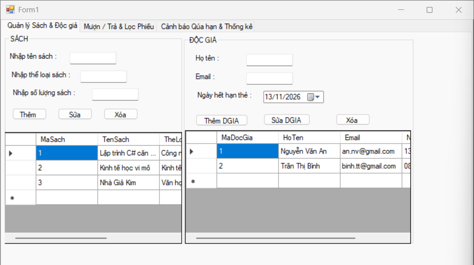
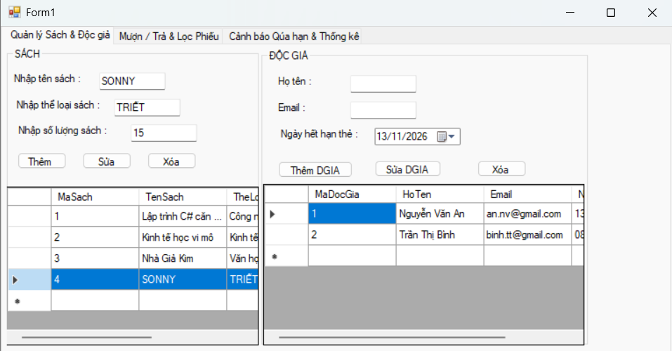
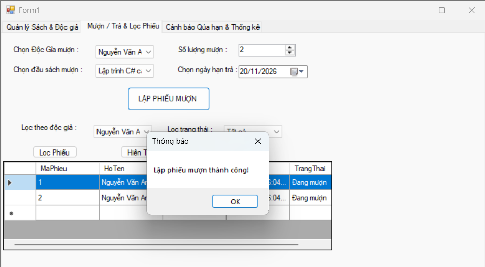
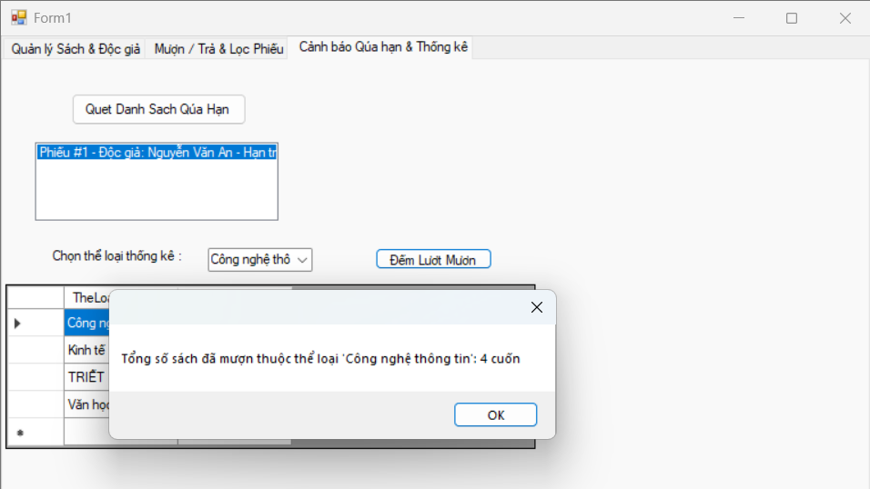
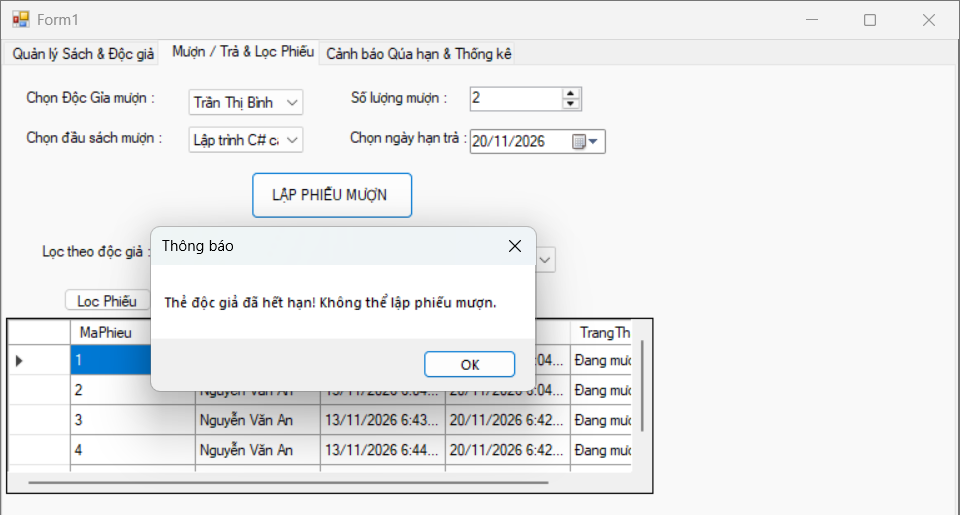
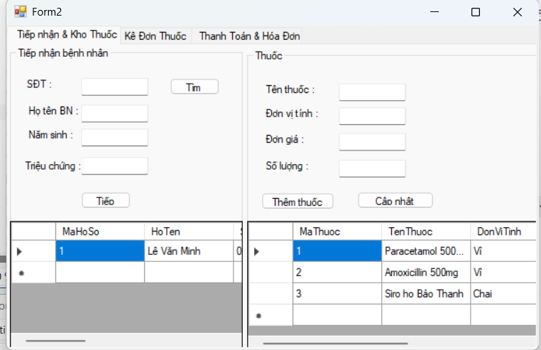
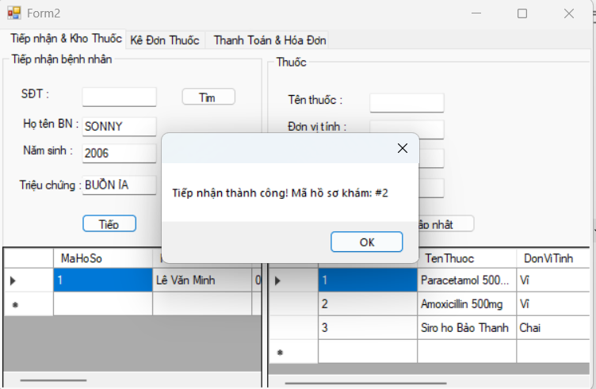
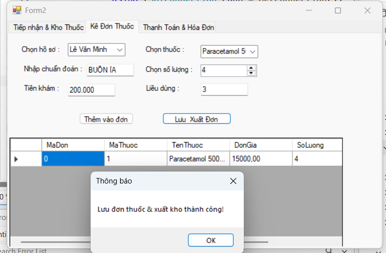
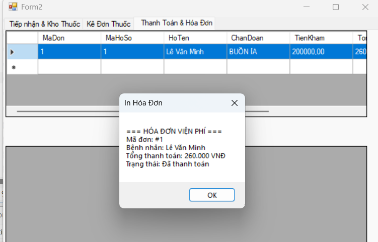
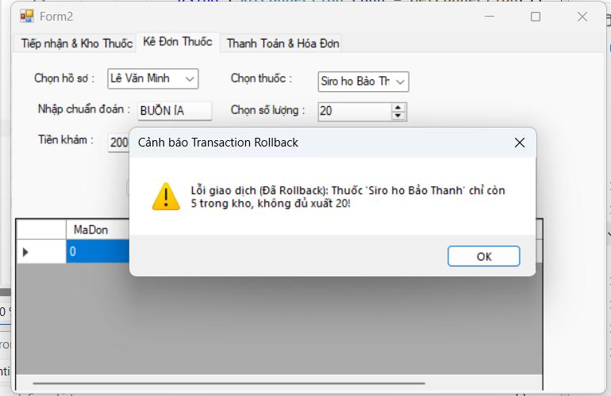

# BÁO CÁO BÀI TẬP THỰC HÀNH LẬP TRÌNH C# WINFORMS (3-TIER & ADO.NET)

## Thông tin Sinh viên
* **Họ và tên:** Nguyễn Đặng Bảo Thái
* **Mã sinh viên:** 24810320333
* **Lớp:** D9QTANM1

---

## BÀI 6.6: HỆ THỐNG QUẢN LÝ MƯỢN TRẢ SÁCH THƯ VIỆN (LIBRARY MANAGEMENT SYSTEM)

1. **Màn hình Chính / Tổng quan hệ thống:**

2. **Màn hình Quản lý Danh mục (CRUD - Thêm/Sửa/Xóa):**

3. **Màn hình Thực thi Nghiệp vụ chính (Mượn / Trả sách & Lọc phiếu):**

4. **Màn hình Báo cáo - Thống kê (Quá hạn & Thống kê theo thể loại):**

5. **Minh họa An toàn Dữ liệu (Chặn thẻ độc giả hết hạn):**

---

## BÀI 6.7: HỆ THỐNG QUẢN LÝ PHÒNG KHÁM & KÊ ĐƠN THUỐC (CLINIC & PHARMACY MANAGEMENT SYSTEM)

1. **Màn hình Chính / Tổng quan hệ thống:**

2. **Màn hình Quản lý Danh mục (CRUD - Tiếp nhận & Quản lý kho thuốc):**

3. **Màn hình Thực thi Nghiệp vụ chính (Kê đơn thuốc & Xuất kho):**

4. **Màn hình Báo cáo - Thống kê (Thanh toán & In hóa đơn viện phí):**

5. **Minh họa An toàn Dữ liệu (Báo lỗi Transaction Rollback khi thiếu tồn kho):**

